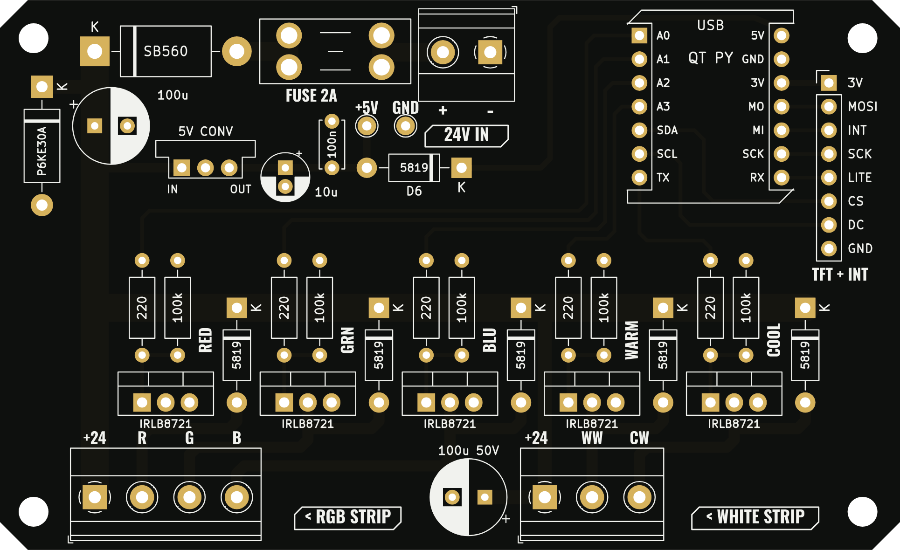

# Task lamp driver board

One circuit board that turns a 24 V supply and a QT Py RP2040 into a five-channel strip
lamp: 0.8 m of RGB tape and 1 m of tunable-white tape, each colour switched by its own
MOSFET.



| | |
|---|---|
| Size | 96.5 × 59 mm, two layers, 1.6 mm |
| Mounting | Four 3.2 mm holes (M3) on a 88.9 × 50.8 mm (3.5 × 2.0 in) rectangle |
| Supply | 24 V DC, 1.5 A or more. About 1.0 A is drawn with every channel at 100 % |
| Outputs | Red, green, blue: about 0.13 A each. Warm white, cool white: about 0.30 A each |
| Controller power | 5 V made on the board from the 24 V input; USB can be plugged in at the same time |
| Parts | All through-hole. Most are in the inventory; nine lines to buy ([`docs/parts-to-order.md`](../docs/parts-to-order.md)) |

## What is on it

```
 24 V in ─ fuse ─ Schottky ─┬───────────────┬──────────────── +24 V to both strips
          (2 A)  (reverse   │               │
                 protection)│               └─ 5 V converter ─ diode ─ QT Py 5V pad
                           TVS, 2 × 100 µF

 QT Py pin ── 220 Ω ──┬── gate ┐
                    100 kΩ     │ IRLB8721      × 5: red, green, blue, warm, cool
                      │   source ── ground
                    ground  drain ── strip colour wire, and a 1N5819 up to +24 V
```

* **Input.** Fuse first, then a Schottky diode so a supply wired backwards reaches nothing,
  then a TVS diode and two bulk capacitors on the 24 V rail.
* **5 V supply.** A switching converter module (78xx pinout) feeds the QT Py's 5V pad
  through a diode. The QT Py has its own diode from USB, so either source, or both, can
  be connected.
* **Five identical switches.** The QT Py pin drives the MOSFET gate through 220 Ω. The
  100 kΩ pull-down keeps the strip dark whenever the pin is not driving: during reset,
  while a new program loads, or with the QT Py unplugged. The 1N5819 returns the kick
  from the strip wiring to the rail when the MOSFET turns off.
* **Display header.** Seven wires to the TFT and one to the encoder's INT pad. The encoder
  itself plugs into the QT Py's STEMMA QT socket.

The full schematic is [`tasklamp-driver-schematic.pdf`](tasklamp-driver/tasklamp-driver-schematic.pdf)
([picture](tasklamp-driver/img/schematic.png)).

## Files

| File | What it is |
|---|---|
| `tasklamp-driver/tasklamp-driver-gerbers.zip` | **Upload this to PCBWay.** Seven Gerber layers and two drill files |
| `tasklamp-driver/tasklamp-driver.kicad_pro` | The KiCad project (KiCad 7 or newer): schematic and board, editable |
| `tasklamp-driver/tasklamp-driver-schematic.pdf` | Schematic |
| `tasklamp-driver/tasklamp-driver-bom.csv` | Every part, with where it comes from |
| `tasklamp-driver/gerbers/` | The same factory files unzipped, plus drill maps |
| `tasklamp-driver/img/` | Pictures of both sides, rendered from the Gerber files |
| `tasklamp-driver/test-report.md` | **What was tested and what it showed**: circuit simulations and checks of the factory files |
| `tasklamp-driver/sim/` | Simulation results (`results.json`) and plots |
| `tasklamp-driver/board-tests.json` | Results of the factory-file checks |

## Ordering the boards from PCBWay

1. On pcbway.com choose **PCB Instant Quote** and upload
   `tasklamp-driver-gerbers.zip`. The size (96.5 × 59 mm) and layer count (2) are read
   from the file.
2. Keep FR-4, 1.6 mm and 1 oz copper, and set these for the board's look (Neon Noir
   Chartreuse, revision B):

   | Option | Choose |
   |---|---|
   | Solder mask | **Matte black** (plain black if matte isn't offered) |
   | Silkscreen | **White** |
   | Surface finish | **ENIG** |

   Black mask and ENIG cost more than green and HASL; the quote shows the difference.
   The circuit works the same with any colour and finish, so green with HASL is fine if
   you'd rather save it. Nothing needs a special process: the narrowest track is 0.4 mm,
   the closest copper 0.4 mm apart, the smallest hole 0.8 mm, and there are no vias.
3. Quantity 5 is the minimum and usually the cheapest tier.
4. Look at PCBWay's own preview before paying. It should look like the two pictures in
   `tasklamp-driver/img/`.

With green and HASL, expect about $5 for the boards plus shipping. US orders also pay
import duty, collected at checkout; see [`docs/pcb-planning.md`](../docs/pcb-planning.md)
for the alternatives (OSH Park makes boards in the US from the same files, with ENIG as
standard).

## Building it

The same steps, with a picture of the board for each one, are in the build booklet:
[`docs/driver-build.html`](../docs/driver-build.html).

Solder the low parts first so the board lies flat. Every position has its value printed
inside the outline.

| Step | Parts | Which way round |
|---|---|---|
| 1 | R1–R5, **220 Ω** (red, red, black, black, brown) | Either way |
| 2 | R6–R10, **100 kΩ** (brown, black, black, orange, brown) | Either way |
| 3 | D1–D6, **1N5819** | Stripe toward the **K** mark and the band on the outline |
| 4 | D7 **SB560** and D8 **P6KE30A** | Stripe toward **K** |
| 5 | C5, **100 nF** ceramic (marked 104) | Either way |
| 6 | Two **1×7 sockets** and the 8-pin header J4 | Plug the sockets onto the QT Py's pins first and solder them with the QT Py in place, so they end up straight and parallel |
| 7 | Fuse holder F1, screw terminals J1, J2, J3 | Wire openings toward the board edge |
| 8 | C1, C2 **100 µF** and C4 **10 µF** | Long lead in the hole marked **+**. The stripe on the can goes over the filled half of the circle |
| 9 | U2, the **5 V converter** | Pin 1 (+Vin) in the square pad marked **IN**. See the note below |
| 10 | Q1–Q5, **IRLB8721**, the five picked below | Metal tab toward the resistors, printing toward the screw terminals. The outline has a second line on the tab side |

**The converter can be fitted backwards**, because its three pins are in a row. Pin 1 is
the input. Find it from the drawing in the module's datasheet before soldering; if that
leaves any doubt, test the loose module with a 9 V battery: battery + on the pin you
think is pin 1, battery − on the middle pin, and the third pin must read 5 V. The first
power-up check below also catches a reversed converter before it can reach the QT Py.

The IRLB8721 shares its package with other parts in the inventory (IRFZ44N, the 78xx
regulators). Read the printing on each one: only IRLB8721 goes in Q1–Q5.

### Picking the five MOSFETs

The gates are driven from 3.3 V, and the IRLB8721's datasheet only guarantees full
conduction at 4.5 V. For a typical part that doesn't matter: it is fully on with a large
margin. The simulation (see the test report) shows that a part at the very top of the
datasheet's threshold range would still be on in a warm room, but in a cold one its margin
could shrink to almost nothing. There are 19 in the inventory and the board takes five, so
pick the best five first. It takes a few minutes:

1. Clip the **gate and drain** (the left and middle legs, printing toward you) together.
2. **9 V battery +** through a **1 kΩ** resistor to those two legs; **battery −** to the
   right leg (source).
3. Measure from the left leg to the right leg. A typical part reads **about 2.0–2.2 V**.
4. Measure them all, fit the **five lowest**, and set aside any that read **above 2.6 V**.
   A part reading 2.6 V or less keeps at least 0.1 V of margin even at 0 °C.

## First power-up

Do these in order. Each one protects the step after it.

1. **Nothing plugged in: no QT Py, no strips, no display.** Fit the fuse and connect 24 V
   to J1 (**+** and **−** are printed beside it, and on the back).
   * Between **+24** on either strip terminal and the **GND** test pad: about 23.5 V
     (the supply less the Schottky's drop).
   * Between the **+5V** and **GND** test pads: 4.9 to 5.1 V.
     If this is wrong, stop. Anything else here would put the wrong voltage on the QT Py.
2. **Strips connected, still no QT Py.** Nothing may light. The pull-downs are holding
   every MOSFET off.
3. **Power off. Plug in the QT Py**, USB socket toward the board edge, and connect the
   display and encoder. Power on: the display starts and the lamp fades up.
4. **One colour at a time.** In *Settings ▸ Channels*, open each channel in turn. Only
   that colour may light. If a different colour lights, two wires are swapped at the
   terminal.
5. **Are the MOSFETs fully on?** Set a channel to 100 % (Mixer mode) and measure from that
   colour's screw terminal to the GND test pad: it must read **under 0.1 V**. Simulated, a
   typical part reads about 0.004 V. This is the check that matters, because the datasheet
   only guarantees 4.5 V drive. A channel that reads higher gets another IRLB8721 from the
   bag.
   With that colour **off**, the same screw reads anything from about 5 V up to 24 V: the
   strip's LEDs hold back part of the 24 V. Only 0 V means a fault (a bridge at the MOSFET).
6. **Calibrate** as the main README describes: *Min duty* per channel, then measured
   currents under *Power*. The Min duty defaults, 0.12 % for red and 0.16 % for the other
   colours, come from simulating this board, so the right setting should be near them.

## Wiring

| Terminal | Goes to |
|---|---|
| **24V IN +, −** | The 24 V supply |
| **RGB STRIP +24, R, G, B** | The RGB tape's four wires. Match the letters printed on the tape at the cut line; wire colours vary |
| **WHITE STRIP +24, WW, CW** | The tunable-white tape's three wires: its common +, warm, cool |
| **J4: 3V, GND, SCK, MOSI, CS, DC, LITE** | TFT pads Vin, GND, SCK, SI, TCS, D/C, Lite |
| **J4: INT** | The encoder board's INT pad |
| QT Py STEMMA QT socket | The encoder board, with its own cable |

Cut the tapes only at the marked copper pads: every 100 mm on the RGB tape, so 800 mm is
eight segments.

## How the board was checked

The board is not drawn by hand. `tools/pcb/design.py` lists every part and what each pin
connects to; `tools/pcb/build.py` generates the schematic and the board from it and then
refuses to write factory files unless all of this holds:

* the netlist KiCad extracts from the **schematic** is exactly the list in `design.py`
  (28 nets, 40 parts);
* every pad on the **board** is on the net `design.py` gives it;
* KiCad's **design-rule check** finds no violation and nothing left unrouted;
* the outline, the QT Py socket spacing (taken from Adafruit's own board file) and the
  terminal pitch are right, there are no vias, and nothing is routed on the ground layer;
* four faults planted on purpose are each reported: a short, a 0.05 mm gap, a missing
  track, and two swapped wires;
* the exported **drill files** hold the same 103 holes, at the same places and sizes, as
  the board.

The pictures in `img/` are rendered from the Gerber files by a different program
(tracespace), not from KiCad's view of the board.

Two more test suites go further. Their results, with what each one assumed, are in
[`tasklamp-driver/test-report.md`](tasklamp-driver/test-report.md):

* **`tools/pcb/test_board.py`** (22 checks) reads the factory files back as shapes,
  without KiCad, traces the copper into nets and compares them with `design.py`, then
  measures everything the board maker and the circuit care about: track widths and gaps,
  drills and annular rings, mask openings and dams, silkscreen line widths, heating and
  voltage drop in the tracks, clearance at 24 V, whether each part's leads fit its holes,
  which way the screw terminals face, the firmware's pin map and each part's pinout.
* **`tools/sim/run.py`** (17 checks) simulates the circuit in ngspice: all channels on,
  the 3.3 V gate drive across the MOSFET's whole threshold range, switching and the bottom
  of the dimming range, turn-off spikes, plugging in a live supply, a reversed supply, the
  5 V and USB power paths, floating pins and supply ripple.

They found four things, all fixed: the firmware's Min duty defaults were well below the
dead band the simulation shows; the library footprints' 0.12 mm silkscreen lines are
thinner than the board maker prints reliably (now 0.15 mm); the MOSFET holes were too
tight for TO-220 leads at the large end of their tolerance (1.1 mm, now 1.3 mm); and the
solder-mask openings were exactly pad-sized (now 0.05 mm larger all round).

What has **not** been done: nobody has built one. Footprints come from KiCad's standard
library except the QT Py socket, whose pad positions are from Adafruit's design files.
Before ordering, it is worth printing the top layer at 100 % and holding the real parts
against it, above all the fuse holder, the converter and the screw terminals.

To regenerate after a change (needs KiCad 7 or newer; the test suites also need ngspice,
and Python with `gerbonara`, `shapely` and `matplotlib`):

```
/usr/bin/python3 tools/pcb/build.py     # KiCad project, checks, factory files
node tools/pcb/render.js                # pictures, from the factory files
/usr/bin/python3 tools/pcb/guide.py     # the build booklet, drawn on those pictures
python3 tools/sim/run.py                # circuit simulations
python3 tools/pcb/test_board.py         # checks of the factory files
```

## Design notes

* **Why the gates need no driver.** Each MOSFET switches at most 0.3 A. A typical
  IRLB8721 with 3.3 V on its gate is far into conduction at that current (about 4 mV
  across it, simulated) and dissipates about a milliwatt, so there are no heatsinks and
  the parts stay cold. Only a part at the top of the datasheet's threshold range would be
  marginal, and then only when cold, which is what the five-from-nineteen screening and
  the 0.1 V check take care of. A 5 V gate buffer would remove even that, at the cost of
  another chip and a board revision; it isn't needed for these strips.
* **Why a 30 V MOSFET is enough on a 24 V rail.** A MOSFET that is on has its drain at
  ground. One that is off is reached from the rail only through its LED string and the
  leakage of its clamp diode, which can pass a few milliamps at most, far too little to
  hurt it even if a surge lifts the rail. The kick from the strip wiring at turn-off is
  clamped half a volt above the rail by the 1N5819.
* **One ground plane.** The whole bottom layer is ground and everything else is routed on
  top, so the return current of every track runs directly underneath it. There are no
  vias to fail.
* **Copper sized for more.** The 24 V paths are 3 mm wide and the outputs 1.2 mm, good for
  about 3 A in total (the input diode is what sets that). Longer strips need only a larger
  fuse, up to 3 A, and a repeat of the 0.1 V check above.
* **24 V only.** The TVS begins to conduct near 29 V and the MOSFETs are 30 V parts. Do
  not use a higher supply voltage.
* **What it does not have.** No power LED (it would glow inside the lamp at night), and no
  connector for the encoder, which uses the QT Py's own socket.
