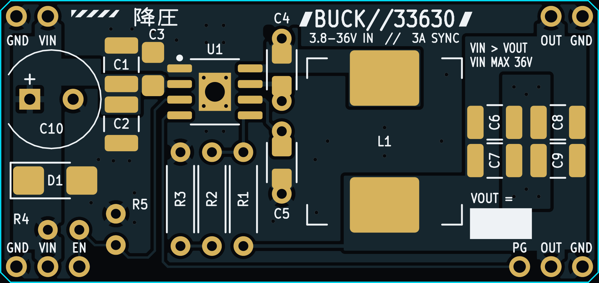
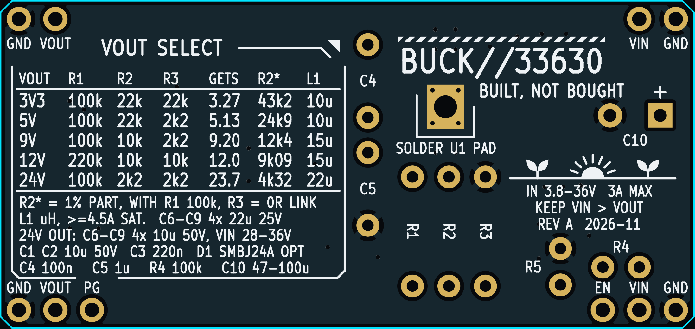
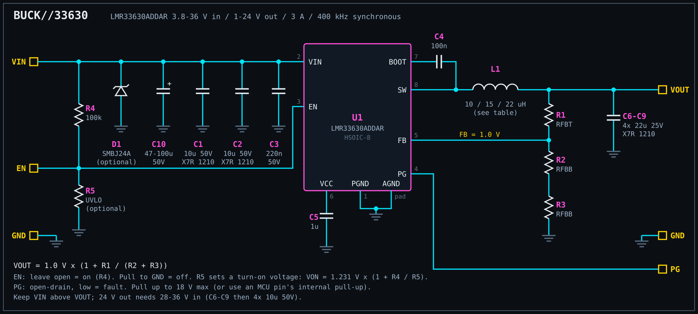
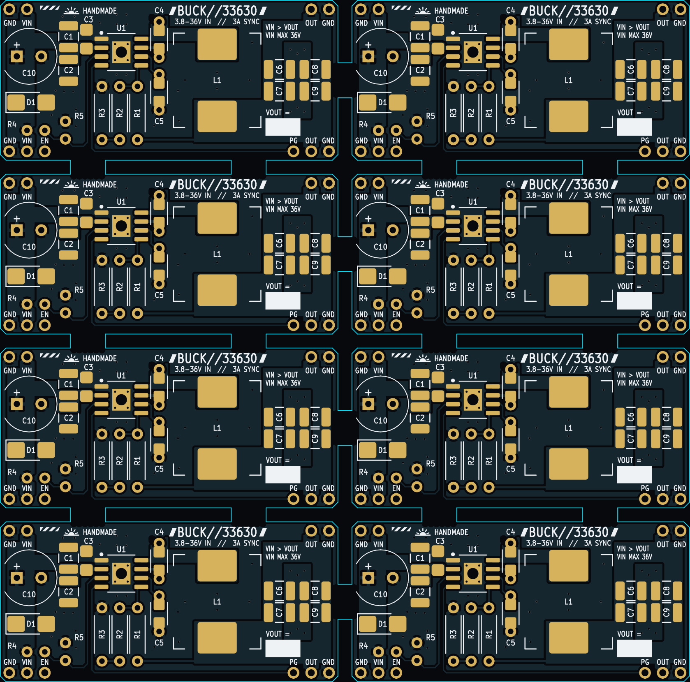

# BUCK//33630: adjustable 3 A buck converter breakout

A small step-down converter board built around the **TI LMR33630ADDAR**. One board
design covers every output from 3.3 V to 24 V; you pick the voltage at assembly
time by fitting the resistors and inductor listed on the back of the board.




| | |
|---|---|
| Input | 3.8 V to 36 V (38 V absolute maximum) |
| Output | 1 V to 24 V, set by resistors. Table for 3.3, 5, 9, 12 and 24 V |
| Current | 3 A (see [Heat](#heat-and-efficiency) for continuous use) |
| Type | Synchronous buck, 400 kHz, internally compensated |
| Standby | Tens of microamps with no load (24 µA in the chip plus the feedback divider) |
| Board | 48.26 × 22.86 mm (1.9 × 0.9 in), 2 layers, parts on one side |
| Breadboard | Two rows of pins 0.8 in apart, 10 pins |
| Panel | 2 × 4 boards, 98.5 × 97.4 mm, snap apart by hand |

**Status: designed and rule-checked, not yet built.** Both board files pass KiCad's
design-rule check with no violations, and the fabrication files are ready to order.
Nothing here has been soldered or measured, so treat the first panel as the
prototype. [What to check on the first board](#bring-up) is listed below.

---

## Two limits to know before building

**A buck converter only steps down.** The output is always lower than the input,
so not every combination in "3.3 to 24 V out from 5 to 24 V in" is possible:

| You want | You need |
|---|---|
| 3.3 V | 4.5 V in or more |
| 5 V | 6 V in or more |
| 9 V | 10 V in or more |
| 12 V | 13 V in or more. A 12 V battery sags below that, so the output just follows the battery, about 0.2–0.4 V lower |
| 24 V | **28 to 36 V in.** From a 24 V supply you get roughly 23.5 V, unregulated |

If a project needs 24 V from 12 V, or a steady 12 V from a vehicle battery, that
calls for a boost or buck-boost converter: a different chip and board.

**36 V is the ceiling.** That covers 5, 12 and 24 V supplies and 12 V vehicles
(with the fuse and TVS diode described under [Vehicle use](#vehicle-use)). It does
not cover 24 V truck electrics, 36 V or 48 V battery packs.

---

## Why the LMR33630

Requirements: adjustable 3.3–24 V out, 5–24 V in, hand-solderable, and the best mix
of efficiency, performance and cost from what DigiKey stocks.

| Part | Input | Current | Type | Package | Verdict |
|---|---|---|---|---|---|
| **TI LMR33630ADDAR** | 3.8–36 V | 3 A | Synchronous, 400 kHz | HSOIC-8, 1.27 mm pitch | **Chosen** |
| TI LMR51430 | 4.5–36 V | 3 A | Synchronous | SOT-23-6 | Cheaper (about \$1.60), but the tiny package is harder to solder and sheds heat poorly at 3 A |
| TI LMR38020 | 4.2–80 V | 2 A | Synchronous | HSOIC-8 | Good for 48 V systems. Costs more (about \$3) for less current |
| TI TPS54360B | 4.5–60 V | 3.5 A | Non-synchronous | HSOIC-8 | Needs an external diode and a compensation network; lower efficiency |
| TI LM2596 | 4.5–40 V | 3 A | Non-synchronous, 150 kHz | TO-220 / TO-263 | Easiest to solder, but 10 or more points less efficient at 3.3–5 V, 5 mA standby, and needs a much larger inductor |

What decided it:

* **The output range is exactly the one asked for.** The datasheet rates it for
  1 V to 24 V out.
* **Synchronous.** No catch diode, and peak efficiency above 95 % per the datasheet.
* **Few parts.** It is internally compensated, so two resistors set the voltage.
* **The friendliest package a modern synchronous buck comes in.** An 8-pin SOIC
  with 1.27 mm pin pitch and a thermal pad.
* **Low standby current** (24 µA), which matters for anything left wired to a
  battery.
* **A pin-compatible family.** LMR33620 (2 A) and LMR33640 (4 A) drop onto the
  same pads.
* **Price and supply.** Listed active at DigiKey, about \$2.00–2.60 each in single
  quantities.

Prices are from DigiKey's regional listings as shown in search results in
November 2026. DigiKey's site blocks automated access, so I could not check live
stock or build a cart; confirm both when you order. Facts about the chip are from
TI's datasheet (SNVSAN3F), which I read in full.

---

## Circuit



| Part | Job |
|---|---|
| U1 | The regulator: both power switches, controller and compensation |
| C1, C2, C3 | Input capacitors. They sit right at the VIN and PGND pins, because the loop they form with the chip carries the fast switching current |
| C10 | Bulk electrolytic. Damps ringing when the supply arrives over long wires |
| D1 | Optional TVS diode for spikes on the input; also blows the fuse if the input is connected backwards |
| C4 | Bootstrap capacitor for the high-side switch driver |
| C5 | Bypass for the chip's internal 5 V supply |
| L1, C6–C9 | Output filter |
| R1, R2, R3 | Feedback divider. VOUT = 1.0 V × (1 + R1 / (R2 + R3)) |
| R4 | Pulls EN up to VIN so the converter runs with nothing connected to EN |
| R5 | Optional. With R4 it sets a minimum input voltage for turn-on |

---

## Setting the output voltage

This table is printed on the back of every board. R2 and R3 are in series, which
lets ordinary resistor-kit values reach each voltage.

| Output | R1 | R2 | R3 | You get | L1 | C6–C9 |
|---|---|---|---|---|---|---|
| 3.3 V | 100k | 22k | 22k | 3.27 V | 10 µH | 4 × 22 µF 25 V |
| 5 V | 100k | 22k | 2k2 | 5.13 V | 10 µH | 4 × 22 µF 25 V |
| 9 V | 100k | 10k | 2k2 | 9.20 V | 15 µH | 4 × 22 µF 25 V |
| 12 V | 220k | 10k | 10k | 12.00 V | 15 µH | 4 × 22 µF 25 V |
| 24 V | 100k | 2k2 | 2k2 | 23.73 V | 22 µH | 4 × 10 µF 50 V |

All of those resistors are in your kit. Add about ±2.5 % for resistor and
reference tolerance.

**For a more exact voltage**, fit R1 = 100k, a wire link or 0 Ω resistor in R3,
and one 1 % resistor in R2:

| Output | R2 | You get |
|---|---|---|
| 3.3 V | 43k2 | 3.31 V |
| 5 V | 24k9 | 5.02 V |
| 9 V | 12k4 | 9.06 V |
| 12 V | 9k09 | 12.00 V |
| 24 V | 4k32 | 24.15 V |

These five values cost a few cents each, and they are the datasheet's own choices
for 3.3, 5 and 12 V.

For any other voltage: R2 + R3 = R1 / (VOUT − 1). Choose the inductor from the
nearest row, and never go below 0.7 µH per volt of output (datasheet equation 5).

---

## Parts

### From your inventory

| Ref | Value | Inventory | Have | Limits you to |
|---|---|---|---|---|
| R1, R4 | 100k | R-014 | 25 | 12 boards |
| R1 (12 V only) | 220k | R-015 | 25 | |
| R2, R3 | 22k, 10k, 2k2 | R-012, R-011, R-009 | 25, 50, 25 | |
| R3 link (exact option) | 0 Ω | R-001 | 25 | |
| C4 | 100 nF 50 V ceramic | C-021 | 10 | 10 boards |
| C5 | 1 µF 50 V ceramic | C-027 | 10 | 10 boards |
| C10 | 47 µF 50 V or 100 µF 50 V | C-042, C-044 | 8, 6 | 14 boards |
| Pins | 2.54 mm header strip | E-007 | 40 pins | 4 boards |

Two cautions on the kit capacitors. Their dielectric is unverified ("X7R / Y5V"
in the inventory sheet). That is fine on the bench, but Y5V loses most of its
capacitance when hot or cold, so use bought X7R parts for C5 in a vehicle. And
check their lead spacing: the footprints are 5.08 mm, and 2.54 mm parts need their
leads spread.

### To buy

Search DigiKey by these manufacturer part numbers. Quantities are per board.

| Ref | Qty | Part | Part number | Notes |
|---|---|---|---|---|
| U1 | 1 | Buck regulator | TI **LMR33630ADDAR** | [DigiKey listing](https://www.digikey.com/en/products/detail/texas-instruments/LMR33630ADDAR/8554847). Must be the "A" (400 kHz) version in the DDA package |
| L1 | 1 | Inductor 10 µH | Bourns **SRP1265A-100M** | 15.5 A saturation, 13 mΩ. Budget: Bourns SRR1260-100M (5.5 A, 20 mΩ) |
| L1 | 1 | Inductor 15 µH | Bourns **SRP1265A-150M** | 12.5 A, 23 mΩ. Budget: Bourns SRR1260-150M (about 4.6 A, 27 mΩ) |
| L1 | 1 | Inductor 22 µH | Bourns **SRP1265A-220M** | 12 A, 33 mΩ. Or Würth 7447709220 (6.5 A). Not the SRR1260-220M, which saturates at about 3.7 A |
| C1, C2 | 2 | 10 µF 50 V X7R, 1210 | Murata **GRM32ER71H106KA12L** | Or Samsung CL32B106KBJNNNE, TDK C3225X7R1H106K250AC. Also C6–C9 on 24 V builds |
| C6–C9 | 4 | 22 µF 25 V X7R, 1210 | Murata **GRM32ER71E226KE15L** | Or Samsung CL32B226KAJNNNE |
| C3 | 1 | 220 nF 50 V X7R, 0805 or 1206 | KEMET **C0805C224K5RACTU** | Any equivalent. The only small chip part on the board |
| D1 | 1 | TVS diode, SMB | Littelfuse **SMBJ24A** | Optional. See [Vehicle use](#vehicle-use) |
| R2 | 1 | 1 % resistor (exact option) | Yageo **MFR-25FBF52-43K2**, -24K9, -12K4, -9K09, -4K32 | Optional |
| C4, C5 | 1 each | 100 nF and 1 µF 50 V X7R, 1206 | KEMET **C1206C104K5RACTU**, **C1206C105K5RACTU** | Only once the kit parts run out. Buy chips: radial 1 µF X7R parts are bulky (about 7 × 4 mm) and crowd the inductor |
| Pins | 10 | 2.54 mm breakaway header | Any 1 × 40 strip | |

The inductor must not saturate below the chip's current limit. Any shielded
10–13.5 mm SMD inductor fits the pads if it has at least 4.5 A saturation current,
3.5 A RMS current and under 40 mΩ resistance. The SRR1260-150M and -220M figures
above come from a third-party copy of the Bourns datasheet; check them before
ordering those two.

`fab/bom.csv` holds the same list. Expect roughly \$7–9 of parts per converter in
small quantities; the chip is about \$2.30 of that. Passive prices are my estimate,
not checked against a cart.

**Shopping list for one panel (8 boards):** 10 × LMR33630ADDAR, 20 × 10 µF 50 V,
32 × 22 µF 25 V, 10 × 220 nF, inductors to match the voltages you plan to build
(for example 4 × 10 µH, 3 × 15 µH, 1 × 22 µH), two 40-pin header strips, and a few
SMBJ24A for vehicle builds.

---

## The board

```
              ┌──────────────────────────────────────────────┐
   row A      │ GND  VIN                          VOUT  GND  │
              │                                              │
              │   input ── U1 ── inductor ── output caps     │
              │                                              │
   row B      │ GND  VIN  EN                  PG  VOUT  GND  │
              └──────────────────────────────────────────────┘
               ◄── input end                    output end ──►
```

* **Breadboard.** The rows are 0.8 in (20.32 mm) apart and straddle the centre
  gap, leaving free holes beside the board. GND is the outer pin at every corner.
* **Power pins are doubled**, one in each row, so two breadboard contacts share
  the current. Breadboard contacts are only good for about 1 A each; for more
  than 2 A, solder wires to the pads or fit 2.54 mm screw terminals, which drop
  into the same holes.
* **EN** (enable). Leave it open and the converter runs. Pull it to GND to shut
  down. Never drive it above VIN. In shutdown the chip draws 5 µA, plus VIN / R4
  through the pull-up (0.12 mA at 12 V); fit 1 MΩ (R-017) for R4 if that matters.
* **PG** (power good). Open-drain: it pulls low when the output is out of
  regulation. Give it a pull-up of 18 V or less, or use a microcontroller pin's
  internal pull-up.

### Hand-soldering aids

* The chip's pads are 2 mm long, so an iron reaches them past the pins.
* **The thermal pad under the chip is soldered from the back**, through a 1.6 mm
  plated hole. That pad is also the chip's ground connection, so it must be
  soldered. The back of the board marks the spot.
* The input and output capacitors are 1210 chips (3.2 × 2.5 mm) and the inductor
  pads extend beyond its body.
* Resistors, C4, C5 and C10 are through-hole. C4 and C5 also accept an 0805 or
  1206 chip on the same pads.
* C3 is the one small surface-mount part. A through-hole capacitor has too much
  lead inductance to do that job.

### Labels

* **Back:** the output table, the fixed part values, pin names, limits, and a
  reference label beside each through-hole part for checking from the solder side.
* **Front:** part references, pin names, limits, and a white box to write in the
  voltage the board was built for.
* **Maker's marks:** a sunrise, HANDMADE and a pixel-art thumbs-up on the front;
  HACK THE PLANET and a sunrise with two sprigs on the back. The artwork lives in
  `gen/art.py` (the thumbs-up is the `THUMBS_UP` bitmap) if you want your own
  wording or icon.

### Layout

The layout follows the datasheet's guidelines. C3 and C1 sit against the VIN and
PGND pins on the top layer with no vias in that loop. The bottom layer is an
unbroken ground plane. The feedback divider is beside the FB pin and the chip is
between it and the switch node. The thermal pad connects to the ground plane
through the plated hole, four vias inside the pad and six more next to it.

Design rules are 0.2 mm track and gap with 0.3 mm via holes, which any budget
PCB service meets.

No mounting holes: there is no room for them on a board this size without
weakening the power paths. Mount it by its ten pins on perfboard or a host PCB,
or with foam tape under the flat back.

---

## Ordering the panel



Upload **`fab/buck33630-panel-gerbers.zip`**. Eight boards per panel, joined by
break-away tabs with perforations ("mouse bites"). At 98.5 × 97.4 mm it stays
inside the 100 × 100 mm size that prototype services price lowest, and the usual
minimum of five panels gives 40 boards.

| Setting | Value |
|---|---|
| Layers, thickness | 2 layers, 1.6 mm |
| Copper | 1 oz. 2 oz runs cooler at 3 A |
| Solder mask, silkscreen | Black, white (for the look in the renders) |
| Finish | Lead-free HASL, or ENIG for flatter pads |
| Panel | Tell the service the file is already panelized: 8 boards, 1 design |

For single boards instead, upload `fab/buck33630-gerbers.zip`.

The smallest lettering is 0.72 mm tall with 0.12 mm strokes. That is under the
1 mm / 0.15 mm that some services guarantee; it normally prints legibly, but
expect the fine print to be the first thing to suffer at a budget fab.

To separate, flex each board against its neighbour until the tabs snap. The
perforations sit 0.25 mm inside the board edge so the stubs do not stick out;
a pass with a file cleans them up.

---

## Assembly

Decide the output voltage first and read its row off the back of the board.

1. **U1.** Tin one corner pad, slide the chip in with the dot at pin 1, check
   alignment, then solder the other seven pins. Flip the board and feed solder
   into the hole under the chip until it wets the pad and fills the hole. Use a
   chisel tip and flux; the ground plane soaks up heat, so give it several seconds.
2. **C3**, then **C1, C2**, **C6–C9** and **D1** if used (stripe toward the input
   end of the board, as marked).
3. **L1.**
4. **Resistors** R1–R5, then **C4** and **C5**.
5. **C10**, long lead in the square pad marked **+**.
6. **Header pins** last. Push them into a breadboard, set the board on top and
   solder from the top, so the rows come out parallel.
7. Write the voltage in the white box.

### Bring-up

Do this on the first board before connecting anything you care about:

1. Check with a meter that VIN to GND and VOUT to GND are not shorted.
2. Power it from a bench supply at 12 V with the current limit near 100 mA, or
   through a 100 Ω resistor. With no load it should draw well under 1 mA.
3. Measure VOUT. It should match the "you get" column within about 3 %.
4. Add a load (a power resistor or a length of LED strip) and check that the
   voltage holds.
5. Run it at your real load for ten minutes and check the chip and inductor
   temperature.

On this first build, also confirm that the chip and your chosen inductor sit
properly on their pads.

---

## Using it

### Heat and efficiency

Calculated from the datasheet's switch resistances and the inductor's resistance.
These are estimates, not measurements, and are likely a point or two optimistic.

| Conversion | At 1 A | At 3 A | Heat in the chip at 3 A |
|---|---|---|---|
| 12 V → 3.3 V | 94 % | 90 % | 1.0 W |
| 12 V → 5 V | 96 % | 92 % | 1.0 W |
| 24 V → 5 V | 94 % | 91 % | 1.1 W |
| 24 V → 12 V | 97 % | 95 % | 1.2 W |
| 36 V → 24 V | 98 % | 97 % | 1.5 W |

For comparison, an L7805 making 5 V from 24 V is 21 % efficient and turns 19 W
into heat at 1 A.

On a two-layer board this small I expect the chip to run about 50 °C above its
surroundings at 3 A. That is fine on an open bench. In a closed box or a hot car,
plan on about 2 A continuous, or order 2 oz copper. The chip protects itself by
shutting down at 165 °C.

### Enable and turn-on voltage

R5 from EN to GND makes the converter wait for a minimum input voltage, and turn
off again about 8 % lower:

| R4 | R5 | Turns on | Turns off | Use |
|---|---|---|---|---|
| 100k | none | 3.8 V | | Always on |
| 100k | 22k | 6.8 V | 6.3 V | Clean start for a 5 V output |
| 100k | 10k + 1k in series | 12.4 V | 11.4 V | Stops a 12 V battery being run flat |
| 100k | 10k | 13.5 V | 12.4 V | Runs only while the alternator is charging |

Turn-on voltage = 1.231 V × (1 + R4 / R5). The divider draws VIN / (R4 + R5) all
the time, about 0.1 mA at 12 V with these values. Where standby drain matters,
use 1 MΩ for R4 and ten times the R5 value.

### Vehicle use

* Fuse the feed near the battery (3 A to 5 A).
* Fit **D1 (SMBJ24A)**. It clips fast spikes from motors and relays, and if the
  input is ever connected backwards it conducts and blows the fuse.
* Use bought X7R capacitors, not the kit ones, for C4 and C5.
* The 36 V limit is adequate for a 12 V car with a modern, internally clamped
  alternator. It is not adequate for 24 V systems.
* D1 starts to conduct at about 27 V. Use it only with inputs of 24 V nominal or
  less that are regulated; an unregulated adapter can idle above that and cook it.
* Leave D1 out when the input is above 24 V. No diode in this size can protect a
  38 V part while standing off a 28–36 V supply.

### Other cautions

* **Keep the input above the output.** If the input can collapse while the output
  is held up by a battery or a large capacitor bank, add a Schottky diode
  (1N5819, D-002) from VOUT to VIN outside the board.
* Do not hang more than about 800 µF on the output.
* If the output overshoots or rings on load steps, try 47–100 pF (C-005 to C-007)
  across R1.

### In the task lamp

The lamp's README asks for a separate 5 V supply for the QT Py. Build one board
for 5 V and feed it from the lamp's 24 V supply. Connect VOUT to the QT Py's 5V
pad through a 1N5819 so USB and the converter cannot back-feed each other; the
kit recipe's 5.13 V leaves about 4.7 V after the diode. Compared with a linear
regulator this saves about 19 V × the logic current in heat.

---

## Files

| Path | Contents |
|---|---|
| `fab/buck33630-panel-gerbers.zip` | Gerbers and drill files for the 2 × 4 panel |
| `fab/buck33630-gerbers.zip` | The same for a single board |
| `fab/bom.csv` | Parts list and the voltage table |
| `fab/drc-*.rpt` | KiCad design-rule reports (0 violations each) |
| `kicad/buck33630.kicad_pcb` | Single board, KiCad 7 or later |
| `kicad/buck33630-panel.kicad_pcb` | Panel |
| `kicad/buck33630.pretty/` | Footprints, reusable in other projects |
| `gen/` | Python scripts that generate all of the above |
| `img/` | Renders and the schematic |

The board is generated from code, so there is no KiCad schematic file; the
schematic above is a drawing of the same netlist (`PARTS` in `gen/build_pcb.py`).
To change values, the table or the layout, edit the scripts and rebuild. This
needs KiCad 7, ImageMagick and librsvg:

```bash
/usr/bin/python3 gen/build_pcb.py
```

```bash
gen/export.sh
```

```bash
python3 gen/bom.py && python3 gen/schematic.py
```

`python3 gen/values.py` prints the design numbers: resistor results, inductor
ripple and the turn-on voltage examples.

`python3 gen/theme_render.py looks.json out_dir` draws both sides of the board in
any solder-mask, silkscreen and pad-finish colours, to preview a look before
ordering. The format of `looks.json` is described at the top of that script.

## Sources

* [LMR33630 datasheet, TI SNVSAN3F](https://www.ti.com/lit/ds/symlink/lmr33630.pdf):
  pinout, limits, design equations, layout rules, package drawing
* [LMR33630ADDAR at DigiKey](https://www.digikey.com/en/products/detail/texas-instruments/LMR33630ADDAR/8554847)
* [KEMET C330C105K5R5TA at DigiKey](https://www.digikey.co.uk/en/products/detail/kemet/C330C105K5R5TA/818165)
  (size of radial 1 µF X7R parts)
* [Bourns SRP1265A series datasheet](https://www.mouser.com/datasheet/2/54/srp1265a-1391487.pdf)
  and [SRR1260-100M at DigiKey](https://www.digikey.ca/en/products/detail/bourns-inc/SRR1260-100M/2127402)
