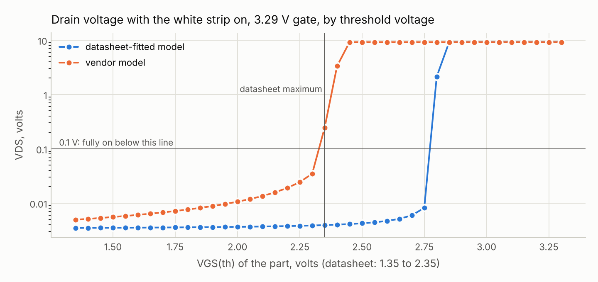
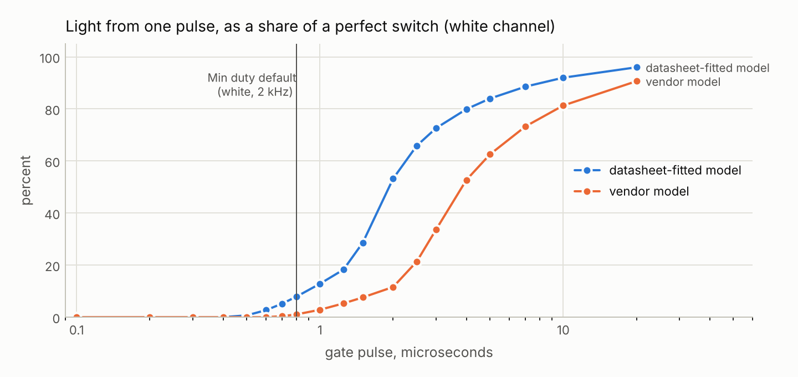
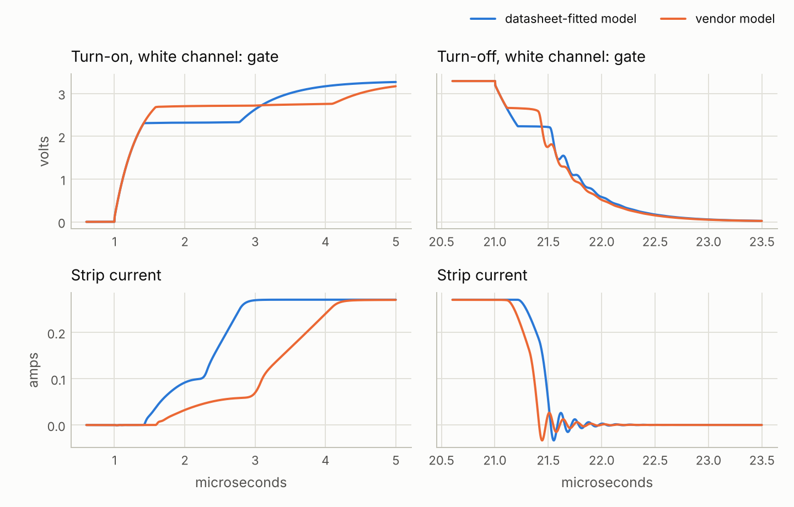
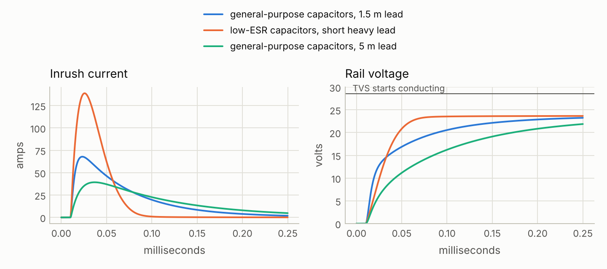

# Driver board test report

Revision B (Neon Noir Chartreuse: matte black mask, white silkscreen, ENIG), firmware
1.2.1. Tested 2026-11-23, before any board has been built.

## Summary

**The board is ready to order.** Three layers of testing agree:

| Suite | What it does | Result |
|---|---|---|
| `tools/pcb/build.py` | Schematic and board against the circuit description, KiCad's design-rule check, four planted faults, drill files read back | all pass |
| `tools/sim/run.py` | The circuit simulated in ngspice | 17 pass, 0 fail |
| `tools/pcb/test_board.py` | The factory files read back as shapes, without KiCad, and measured | 22 pass, 0 fail |

**Found and fixed** (the first runs failed on items 1–3 and measured item 4):

1. **Firmware Min duty defaults** were 0.03 %. The simulated dead band at 2 kHz is
   0.12 % for red and 0.16 % for the other colours, so the bottom few knob steps would
   have stayed dark. Firmware 1.2.1 starts from the simulated values.
2. **Silkscreen lines** in KiCad's library footprints are 0.12 mm, thinner than the board
   maker prints reliably. Now 0.15 mm.
3. **MOSFET holes** were 1.1 mm. TO-220 leads can measure 1.19 mm corner to corner, which
   a 1.1 mm hole at the small end of its tolerance won't take. Now 1.3 mm, still leaving a
   0.30 mm copper ring.
4. **Solder-mask openings** were exactly the size of the pads, so the mask's registration
   tolerance could creep onto them. Now 0.05 mm larger all round.
5. **The booklet's meter table** said an unlit colour's screw reads 20–24 V. With the strip
   connected, its LEDs hold back part of the 24 V and the reading can be as low as about
   5 V. Corrected to 5–24 V, with 0 V as the fault sign.

**Left for the bench:** pick the five best MOSFETs before soldering (below), test-fit the
parts in a bare board, and do the power-up checks in `hardware/README.md`.

## 1. Circuit simulation

`tools/sim/run.py` builds each test circuit from the board's values, runs ngspice and
checks the result. Results are in [`sim/results.json`](sim/results.json).

| Test | Result | Status |
|---|---|---|
| T0a On-resistance | Vendor model 6.4 / 13.6 mΩ at 10 V / 4.5 V gate, fitted model 13.1 mΩ at 4.5 V (datasheet typ 6.5 / 13.1, max 8.7 / 16). Body diode 0.79 V at 25 A (max 1.0) | pass |
| T0b Worst-case model | 8.76 / 16.65 mΩ, at the datasheet maximum | pass |
| T0c Capacitances | Ciss 1080 pF (datasheet 1077), Coss 262 (360), Crss 106 (110) | pass |
| T0d Gate charge, fitted model | 25 A plateau reached at 3.0 nC and 2.88 V (datasheet: 3.1 nC, so about 2.88 V); 9.3 nC to 4.5 V (typ 7.6, max 13) | pass |
| T0e Gate charge, vendor model | Plateau at 3.63 V: 0.75 V above the datasheet | finding |
| T1 Every channel at 100 % | 0.951 A from the supply, rail 23.40 V. MOSFETs drop 1.7 mV (RGB) and 3.6 mV (white); at most 7.6 mV with the vendor model | pass |
| T9 Temperatures | SB560 0.43 W, about 17 K above ambient. Fuse 50 mW. Worst MOSFET about 1 mW | pass |
| T2a Typical MOSFET, 3.29 V gate | 3.6 mV across it at 0.27 A (vendor model 7.6 mV) | pass |
| T2b Highest-threshold MOSFET, 3.20 V gate | 4.5 mV, worst of 0, 25 and 85 °C (fitted model) | pass |
| T2c The same part, vendor model | 93 % of full current at 25 °C, none at 0 °C | pessimistic bound |
| T2d The same part, every datasheet-consistent curve | Needs 2.70–2.96 V on the gate at 25 °C, 2.87–3.16 V at 0 °C. It gets 3.20 V or more | pass |
| T2e Screening limit | A typical part reads 1.99–2.16 V in the 9 V test below; 2.65 V or less keeps 0.1 V of margin at 0 °C | used for the procedure |
| T3a Switching | White channel: on after 0.54 µs, rising over 1.22 µs; off after 0.31 µs, falling over 0.20 µs. 14 mW of switching loss per MOSFET at 20 kHz, the firmware's maximum | pass |
| T3b Min duty defaults | Dead time 0.80 µs (white), 0.79 (green, blue), 0.58 (red): 0.16 / 0.16 / 0.12 % at 2 kHz. Firmware 1.2.1 matches (1.2.0 had 0.03 %: **failed**) | pass |
| T3c Dead time, vendor model | 1.87 / 1.71 / 1.37 µs, about twice as long | upper bound |
| T4 Turn-off spike | Peak drain 14.0 V with a 1 µH strip lead, 23.7 V with 3 µH. Without the 1N5819 clamps: 15.0 V and 30.0 V (the MOSFET's rating) | pass |
| T5 Plugging in a live supply | Inrush 68 A peak (1.5 m lead), 139 A (short heavy lead, low-ESR capacitors), 39 A (5 m lead). The rail never overshoots 23.7 V. At most 0.49 A²s through the fuse, against 5.8 A²s to melt it | pass |
| T6 Supply wired backwards | 0.6 µA flows; the rail sits at −0.02 V | pass |
| T7 QT Py power | 5V pin 4.71 V on 24 V alone, 4.67 V on USB alone, 4.73 V on both (4.92 V with USB at 5.25 V). At most 32 µA, the diode's leakage, flows back into a source | pass |
| T8 Pins left floating | Gate at 0.10 V even with 1 µA of pin leakage; strip dark | pass |
| T10 All channels switching together | Rail ripple 0.24 V peak to peak; each bulk capacitor carries 121 mA rms | pass |

### The 3.3 V gate drive

The MOSFETs are driven straight from the QT Py's 3.3 V pins, and the IRLB8721's datasheet
only guarantees full conduction at 4.5 V. This was the question that needed the most care.

Infineon publishes a simulation model, but it puts the threshold region about 0.75 V higher
than the datasheet's own gate-charge figures do (T0e). Rather than trust it alone, three
views were compared:

* the **vendor model**, as published: the pessimistic bound;
* a **fitted model** that keeps the vendor's capacitances and diode but refits the channel to
  the datasheet's typical threshold, gate-charge plateau and on-resistance;
* an **analytic bound** (the EKV equation) covering every curve that passes through the
  datasheet's two typical points, 25 µA at 1.80 V and 25 A at about 2.88 V, for any
  subthreshold slope from 77 to 148 mV per decade.

<picture>
  <source media="(prefers-color-scheme: dark)" srcset="sim/threshold_sweep-dark.png">
  
</picture>

A typical part is fully on with a very large margin in every view. A part at the top of the
datasheet's threshold range (2.35 V) is fully on in the fitted model and in every
datasheet-consistent curve at room temperature, with 0.24–0.50 V to spare. At 0 °C the
softest curve leaves it only 0.04 V. Only the vendor model, which disagrees with the
datasheet, has it failing.

So the board keeps the direct drive, with two inexpensive safeguards: pick the five best of
the 19 MOSFETs in the inventory before soldering, and measure each channel at full
brightness after assembly (under 0.1 V).

**Picking the five.** Clip gate and drain together, feed them from a 9 V battery through
1 kΩ, battery − to the source, and read the gate-to-source voltage. A typical part reads
about 2.0–2.2 V. Fit the five lowest and set aside any above 2.6 V (T2e allows 2.65 V).

### The bottom of the dimming range

A light pulse is shorter than its gate pulse: the gate needs time to charge up to the point
where the MOSFET conducts, through the QT Py pin and the 220 Ω resistor. Pulses shorter than
about 0.6–0.8 µs give almost no light. The firmware starts each channel at its *Min duty* so
that the first step of the knob gives the first visible light, which is why its default has to
match this dead time.

<picture>
  <source media="(prefers-color-scheme: dark)" srcset="sim/dimming_floor-dark.png">
  
</picture>

The fitted model's dead time gives the new defaults. The vendor model's is about twice as
long, so if the lowest knob steps stay dark on the real lamp, raise Min duty; the calibration
step in the main README finds the exact value either way. The dead band is a time, so at a
higher PWM frequency it is a larger share of each period: at 20 kHz Min duty needs to be ten
times larger. Recalibrate after changing the frequency.

<picture>
  <source media="(prefers-color-scheme: dark)" srcset="sim/pwm_edges-dark.png">
  
</picture>

### Plugging in a live supply

<picture>
  <source media="(prefers-color-scheme: dark)" srcset="sim/hot_plug-dark.png">
  
</picture>

The capacitors' own resistance damps the lead's inductance, so the rail rises without
overshooting. The fuse sees less than a tenth of the energy it takes to melt it, well inside
the 22 % that Littelfuse allows for a pulse repeated 100,000 times.

### What the simulation assumed

Each assumption is named in `tools/sim/run.py` where it is used:

* Supply lead 1.5 m, 0.1 Ω, 1.5 µH; electrolytic capacitors 0.3 Ω each; the converter's own
  input capacitance 10 µF.
* QT Py pin 100 Ω at its default drive strength, 3.3 V high; strip lead 1 µH.
* LED strips modelled from their catalogue currents at 24 V (0.31 A per white channel,
  0.133 A per RGB colour). The real currents go into *Settings ▸ Power*.
* QT Py, display and encoder together draw 85 mA from the 5 V pin.
* Diode and TVS models are published ones (sources in `tools/sim/models/parts.lib`); the TVS
  model is ST's, so its clamping voltage is typical rather than the Littelfuse worst case.

## 2. The factory files

`tools/pcb/test_board.py` reads the Gerber and drill files that go to PCBWay and works from
those shapes alone. Limits are set above PCBWay's published minimums (4 mil tracks and gaps,
0.15 mm annular ring), with the wider mask dam that black solder mask needs. Results are in
[`board-tests.json`](board-tests.json).

| Test | Result | Status |
|---|---|---|
| B1 Nets in the Gerbers | Copper traced into 28 nets across 97 pins, through 47 top and 80 bottom copper islands and 99 plated holes: exactly the circuit, no opens, no shorts | pass |
| B2 Stray copper | None | pass |
| B3 Track width | Narrowest 0.40 mm (limit 0.15) | pass |
| B4 Copper gaps | Closest 0.40 mm (limit 0.15) | pass |
| B5 Drills | 103 holes in 8 sizes, 0.8 to 3.2 mm | pass |
| B6 Annular ring | Smallest 0.30 mm, 0.26 mm with the hole at its tolerance (limit 0.15) | pass |
| B7 Hole spacing | Closest edges 1.20 mm (limit 0.50) | pass |
| B8 Edge clearance | Copper 0.50 mm, holes 1.72 mm from the board edge | pass |
| B9 Inside the outline | Copper, mask and silkscreen all within it | pass |
| B10 Mask openings | Every pad open, each opening 0.05 mm larger than its pad (was exactly pad-sized) | pass |
| B11 Mask dams | Narrowest 0.30 mm (black-mask limit 0.13) | pass |
| B12 Silkscreen on pads | None | pass |
| B13 Silkscreen line width | Thinnest stroke 0.15 mm (was 0.12: **failed**). In the filled lettering 0.85 % of the ink is thinner, at the rounded ends of curves | pass |
| B14 Text height | Smallest 0.80 mm | pass |
| B15 Track heating | Worst: 0.95 A in a 1.0 mm stretch of +24 V, 1.2 K rise (IPC-2221) | pass |
| B16 Voltage drop | At most 37 mV along the +24 V tracks | pass |
| B17 24 V clearance | 0.50 mm between 24 V copper and anything else (IPC-2221B asks 0.10 mm) | pass |
| B18 Leads in holes | Every lead fits with its hole at the small end of the tolerance (TO-220 at 1.1 mm did not: **failed**) | pass |
| B19 Screw terminals | All three take their wires from the nearest board edge | pass |
| B20 Firmware pin map | All 11 pins in `config.h` land on the right nets | pass |
| B21 PWM outputs | The five colours and the backlight each have their own PWM output (6B, 6A, 5B, 5A, 2A; backlight 2B) | pass |
| B22 Pinouts | MOSFETs, diodes, converter, capacitors and terminals match their datasheets | pass |

## 3. Not covered

* **Nobody has built one.** The power-up sequence in `hardware/README.md` is written so a
  mistake shows on the meter before it can reach the QT Py or the strips.
* **Schematic ERC.** KiCad 7's command line has no electrical rules check. The schematic is
  generated from the same description as the board and checked against it net by net, and
  B22 checks every polarized part's pinout, which covers what ERC would find here.
* **PCBWay's own limits** could not be read from their site from this environment; the
  figures above come from their published capability summaries, and the limits used sit well
  above them.
* **Lead and terminal sizes** come from the parts' drawings, and the screw terminals' wire
  direction from KiCad's footprint drawing. Hold the real parts against a full-size print of
  the top layer before ordering, and test-fit them in a bare board before soldering.
* **The MOSFET's true threshold curve** isn't published, which is why three models are
  compared above. The 0.1 V check after assembly is the real test.
* **A second design-rule check** in PCBEditor was not run: it takes the 880 KB board file
  inline, which is impractical from here. KiCad's check and the Gerber measurements above
  cover the same rules. To get a third opinion, import `tasklamp-driver.kicad_pcb` there.

## Rerunning

```
/usr/bin/python3 tools/pcb/build.py     # KiCad project, build checks, factory files
python3 tools/sim/run.py                # circuit simulations (ngspice; matplotlib for plots)
python3 tools/pcb/test_board.py         # factory-file checks (pcbnew, gerbonara, shapely)
make -C test                            # firmware host tests
```
